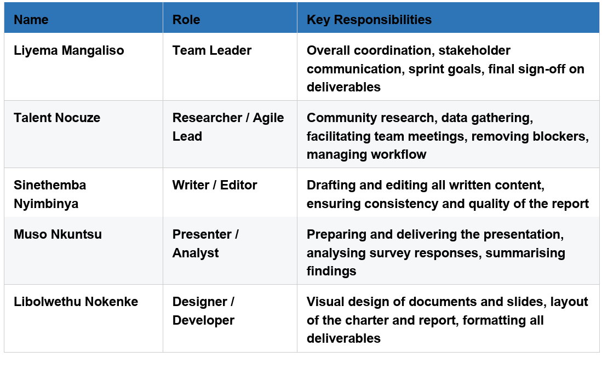

 Agile Team Charter
---

[← Back to Overview](agile_project_portfolio.md) | [Next: User Stories →](stories.md)

# Agile Team Charter

### Evidence

* **Submitted Date:** 4 May 2026
* **Shared Purpose:** Design and deliver a community-focused business solution for Khayelitsha sanitation failures.
* **Roles:** Liyema (Team Leader), Talent (Researcher/Agile Lead), Sinethemba (Writer/Editor), Muso (Presenter/Analyst), Libolwethu (Designer/Developer).
* **Communication Rules:** Daily WhatsApp stand-ups, 3-hour response window for normal queries, 1-hour for urgent blockers.
* **Definition of Done (DoD):** Content reviewed by Sinethemba, design verified by Liyema, research sourced by Talent, slides rehearsed by Muso, final sign-off by Team Leader.

### Reflection
Drafting the charter taught me the difference between a theoretical contract and a living team agreement. As the designated Writer and Editor, my role in enforcing the Definition of Done acted as both a quality assurance measure and a critical dependency. When team members submitted deliverables close to deadlines, balancing strict editorial quality against time constraints required proactive communication and flexibility.Establishing explicit communication channels—specifically daily WhatsApp stand-ups, a 3-hour response window for standard queries, and a 1-hour window for urgent blockers— drasically reduced friction. These predefined rules created mutual accountability, ensuring that technical obstacles and task handoffs were addressed before impacting sprint velocity.Defining clear roles based on individual strengths prevented overlap and duplicated effort. Having a unified purpose—tackling the Khayelitsha sanitation and sewage repair monitoring challenge—kept the team aligned and motivated across the entire project lifecycle, from initial research to final delivery.

---
