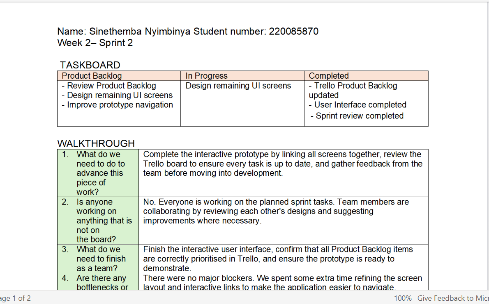

 Agile Logbook
---

[← Back to Overview](overview.md) | [Next: Reflection →](reflaction.md)

# Agile Logbook (28–31 July 2026)

### Stand-up Logs

* **28 July:** Designed 2 new UI screens in Figma. Next: Link UI screens to prototype navigation.
* **29 July:** Successfully resolved Git merge conflicts. Next: Complete remaining screen responsibilities.
* **30 & 31 July:** Consolidated prototype screens and verified Trello board task alignment.

### Reflection
Maintaining a regular logbook transformed documentation from a stressful end-of-project chore into an organic habit. Capturing decisions in real-time during weekly syncs ensured that rationale was never lost to memory, making our final portfolio reflection far more authentic and accurate.Logbook tracking made bottlenecks immediately visible. When technical hurdles arose regarding geolocation mapping and form validation, logging them transparently during daily stand-ups allowed the team to reallocate support quickly before deadlines were compromised.Reviewing our weekly logs during sprint retrospectives enabled a culture of continuous learning. Instead of repeating the same planning errors, our logs highlighted where we tended to over-commit, guiding us toward more realistic capacity planning in subsequent sprints.

---
[← Back to Overview](overview.md) | [Next: Synthesis →](reflaction.md)
